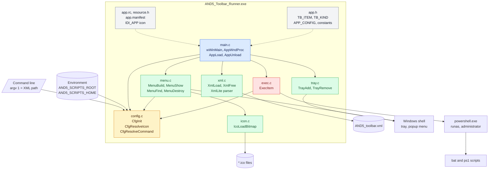
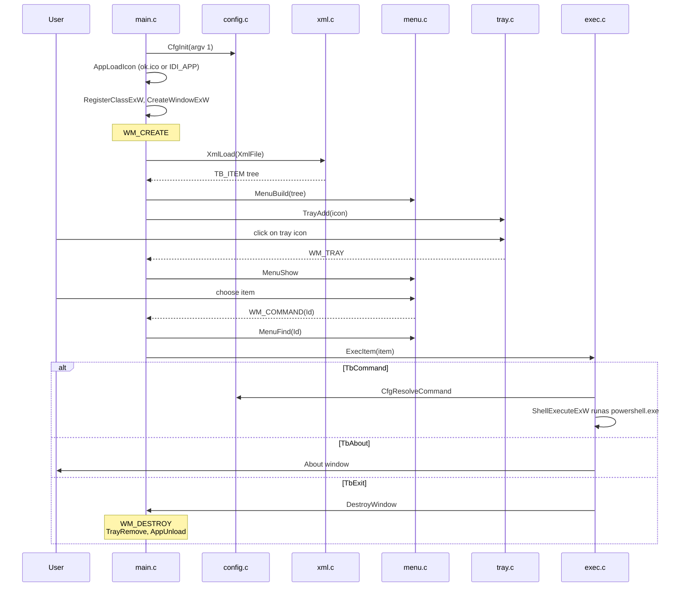
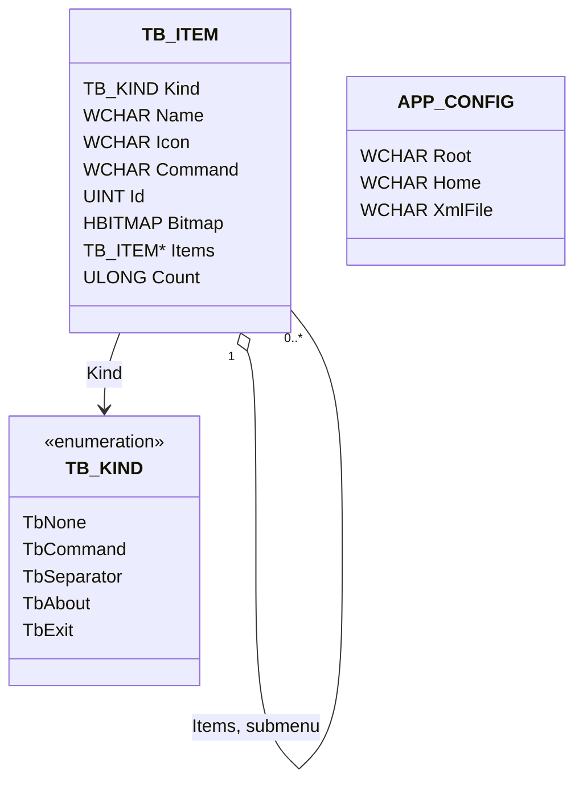

# AND5_Toolbar_Runner

A Windows system tray toolbar. The tray icon opens a menu. The menu is built from `AND5_toolbar.xml`. A menu item runs a script or program as administrator.

It is a port of the PowerShell script `AND5_SCRIPTS_HOME\AND5_com\toolbar\1_AND5_create_toolbar_on_Logon.ps1` to plain C and the Win32 API.

**Status: working.** Open items: single instance, and XML reload without restart.

Full documentation: `F:\DEV_HOME\AI_Projects\AND5_Toolbar_Runner\README_FULL.md`

## UI example

The tray menu of the running program:


## Features

- Tray icon (`Shell_NotifyIconW`), tooltip `Andreys TOOLBAR`.
- Left and right click open the same menu.
- Menu and submenu (one level) come from XML. Items have `.ico` icons.
- `Separator` gives a divider. `About` shows the About window. `Exit` closes the program.
- An item with `<command>` starts `powershell.exe` as administrator (`runas`).
- The icon comes back after an Explorer restart (`TaskbarCreated`).

## Tech stack

- C17, no C++, no runtime.
- Win32 API, XmlLite (DTD prohibited), `ShellExecuteExW`.
- CMake + MSVC (Visual Studio 2022), x64, `/MT`, Unicode, `/W4`.

## AND5_toolbar.xml

```xml
<toolbar>
	<menu>
		<name>TC_DATA</name>
		<icon>AND5_com\toolbar\folder.ico</icon>
		<command>AND5_SCRIPTS_ROOT#AND5_com\daily_scripts\TC_DATA.bat</command>
		<submenu>
			<name>model.xml</name>
			<icon>AND5_com\toolbar\xml.ico</icon>
			<command>AND5_SCRIPTS_ROOT#AND5_com\toolbar\201_open_model_xml.bat</command>
		</submenu>
	</menu>
</toolbar>
```

- `<command>` format: `VARIABLE#relative\path`.
- `<icon>` is relative to `%AND5_SCRIPTS_ROOT%`. It can be empty.

## Environment variables

| Variable | Purpose |
|---|---|
| `AND5_SCRIPTS_ROOT` | Scripts root. Icons and commands are relative to it. |
| `AND5_SCRIPTS_HOME` | Folder with `AND5_toolbar.xml`. |

The XML path is the first command-line argument. If there is none, it is `%AND5_SCRIPTS_HOME%\AND5_toolbar.xml`.

## Source layout

`src\` has `main.c`, `config.c`, `xml.c`, `icon.c`, `menu.c`, `tray.c`, `exec.c`, `app.h`, `app.rc`, `app.manifest`.

## Program structure

### Modules

Arrows show which module calls which. All modules share the types and the `AppConfig` variable from `app.h`.



### Runtime flow



### Data model



## Build

Needs Visual Studio 2022 with the C++ desktop workload. Run in Developer PowerShell:

```powershell
cmake -S F:\DEV_HOME\AI_Projects\AND5_Toolbar_Runner -B F:\DEV_HOME\AI_Projects\AND5_Toolbar_Runner\build -G "Visual Studio 17 2022" -A x64
cmake --build F:\DEV_HOME\AI_Projects\AND5_Toolbar_Runner\build --config Release
```

Result: `bin\AND5_Toolbar_Runner.exe`. One file, no installer.

## Run

```powershell
AND5_Toolbar_Runner.exe                     # XML from %AND5_SCRIPTS_HOME%
AND5_Toolbar_Runner.exe D:\path\my.xml      # custom XML
```

For autostart, put a shortcut in `shell:startup` or use Task Scheduler.

## TODO

- [ ] Single instance (named mutex).
- [ ] Reload XML without restart.
