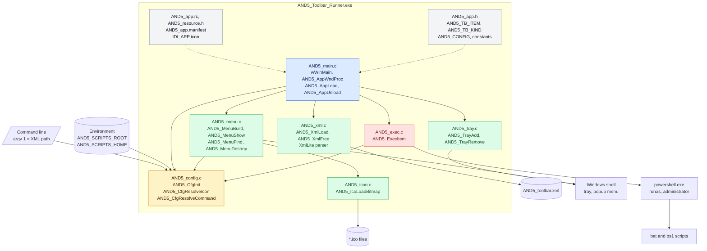
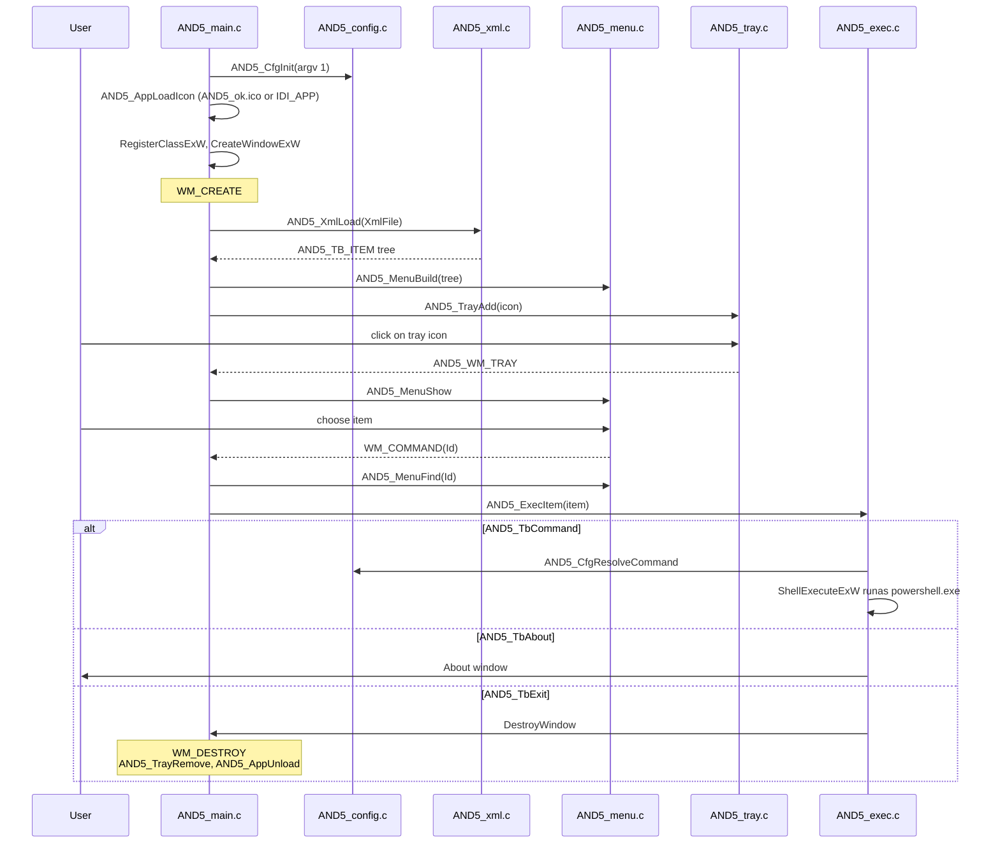
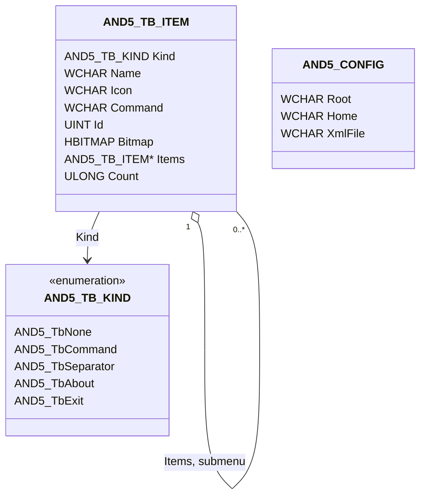

# AND5_Toolbar_Runner

A Windows system tray toolbar. The tray icon opens a menu. The menu is built from `AND5_toolbar.xml`. A menu item runs a script or program as administrator.

It is a port of the PowerShell script `AND5_SCRIPTS_HOME\AND5_com\toolbar\1_AND5_create_toolbar_on_Logon.ps1` to plain C and the Win32 API.

**Status: working.** Open items: single instance, and XML reload without restart.

Full documentation: `F:\DEV_HOME\AI_Projects\AND5_Toolbar_Runner\README_FULL.md`

## Download

**Latest version: [v2026.11.25](https://github.com/AndreyNaralchuk/AND5_Toolbar_Runner/releases/tag/v2026.11.25)**

| Platform | File | Instruction |
|---|---|---|
| Windows x64 | [Download `.exe`](https://github.com/AndreyNaralchuk/AND5_Toolbar_Runner/releases/latest/download/AND5_Toolbar_Runner.exe) | Run `AND5_Toolbar_Runner.exe`. One file, no installer. |

**All versions:** [GitHub Releases](https://github.com/AndreyNaralchuk/AND5_Toolbar_Runner/releases)

## UI example

The tray menu of the running program:


### Install with PowerShell

Run in a normal PowerShell window. The script downloads the program to `%LOCALAPPDATA%\AND5_Toolbar_Runner`, adds a shortcut to autostart and starts the program.

```powershell
$dir = Join-Path $env:LOCALAPPDATA 'AND5_Toolbar_Runner'
$exe = Join-Path $dir 'AND5_Toolbar_Runner.exe'
New-Item -ItemType Directory -Force -Path $dir | Out-Null

# Download the latest release
Invoke-WebRequest -Uri 'https://github.com/AndreyNaralchuk/AND5_Toolbar_Runner/releases/latest/download/AND5_Toolbar_Runner.exe' -OutFile $exe

# Autostart shortcut
$lnk = Join-Path ([Environment]::GetFolderPath('Startup')) 'AND5_Toolbar_Runner.lnk'
$sc = (New-Object -ComObject WScript.Shell).CreateShortcut($lnk)
$sc.TargetPath = $exe
$sc.WorkingDirectory = $dir
$sc.Save()

# Start now
Start-Process $exe
```

The program needs the variable `AND5_SCRIPTS_HOME` (folder with `AND5_toolbar.xml`), or a path to the XML file as the first argument. Set the variable once:

```powershell
[Environment]::SetEnvironmentVariable('AND5_SCRIPTS_HOME', 'D:\path\AND5_SCRIPTS_HOME', 'User')
```

To remove the program: delete the folder `%LOCALAPPDATA%\AND5_Toolbar_Runner` and the shortcut `AND5_Toolbar_Runner.lnk` in `shell:startup`.

## Features

- Tray icon (`Shell_NotifyIconW`), tooltip `Andreys TOOLBAR`.
- Left and right click open the same menu.
- Menu and submenu (one level) come from XML. Items have `.ico` icons.
- `Separator` gives a divider. `About` shows the About window. `Exit` closes the program.
- An item with `<command>` starts `powershell.exe` as administrator (`runas`).
- The icon comes back after an Explorer restart (`TaskbarCreated`).

## Tech stack

- C17, no C++, no runtime.
- Win32 API, XmlLite (DTD prohibited), `ShellExecuteExW`.
- CMake + MSVC (Visual Studio 2022), x64, `/MT`, Unicode, `/W4`.

## AND5_toolbar.xml

Minimal example `AND5_SCRIPTS_HOME\AND5_toolbar.xml`:

```xml
<?xml version="1.0" encoding="utf-8"?>
<toolbar>
	<menu>
		<name>About</name>
		<icon>AND5_com\toolbar\about.ico</icon>
		<submenu>
			<name>About</name>
			<icon>AND5_com\toolbar\about.ico</icon>
		</submenu>
		<submenu>
			<name>Exit</name>
			<icon>AND5_com\toolbar\exit.ico</icon>
		</submenu>
	</menu>
	<menu>
		<name>Separator</name>
		<icon />
	</menu>
	<menu>
		<name>Task Manager</name>
		<icon>AND5_com\daily_scripts\Task_Manager.ico</icon>
		<command>AND5_SCRIPTS_ROOT#AND5_com\daily_scripts\Task_Manager.bat</command>
	</menu>
</toolbar>
```

- `<command>` format: `VARIABLE#relative\path`. Without `VARIABLE#` the path is relative to `%AND5_SCRIPTS_ROOT%`.
- `<icon>` is relative to `%AND5_SCRIPTS_ROOT%`. It can be empty.

### Minimum for a working file

- Needed: one `<menu>` with `<name>`. The root tag name is not checked.
- Not needed: `<icon>`, `<command>`, `<submenu>`.
- Not allowed: `<!DOCTYPE>` (DTD is prohibited).
- `<name>Exit</name>` without `<command>` closes the program. `<name>About</name>` without `<command>` shows the About window.
- An item with a name but no `<command>` (and not About or Exit) is shown, but a click does nothing.
- If the XML is broken, missing, or has no `<menu>`, the program shows a fallback menu with `About` and `Exit` only.

Smallest useful file:

```xml
<toolbar>
	<menu>
		<name>Task Manager</name>
		<command>AND5_com\daily_scripts\Task_Manager.bat</command>
	</menu>
	<menu>
		<name>Exit</name>
	</menu>
</toolbar>
```

## Environment variables

| Variable | Purpose |
|---|---|
| `AND5_SCRIPTS_ROOT` | Scripts root. Icons and commands are relative to it. |
| `AND5_SCRIPTS_HOME` | Folder with `AND5_toolbar.xml`. |

The XML path is the first command-line argument. If there is none, it is `%AND5_SCRIPTS_HOME%\AND5_toolbar.xml`.

## Source layout

`src\` has `AND5_main.c`, `AND5_config.c`, `AND5_xml.c`, `AND5_icon.c`, `AND5_menu.c`, `AND5_tray.c`, `AND5_exec.c`, `AND5_app.h`, `AND5_app.rc`, `AND5_app.manifest`.

## Program structure

### Modules

Arrows show which module calls which. All modules share the types and the `gl_AND5_AppConfig` variable from `AND5_app.h`.



### Runtime flow



### Data model



## Build

Needs Visual Studio 2022 with the C++ desktop workload. Run in Developer PowerShell:

```powershell
cmake -S F:\DEV_HOME\AI_Projects\AND5_Toolbar_Runner -B F:\DEV_HOME\AI_Projects\AND5_Toolbar_Runner\build -G "Visual Studio 17 2022" -A x64
cmake --build F:\DEV_HOME\AI_Projects\AND5_Toolbar_Runner\build --config Release
```

Result: `bin\AND5_Toolbar_Runner.exe`. One file, no installer.

## Run

```powershell
AND5_Toolbar_Runner.exe                     # XML from %AND5_SCRIPTS_HOME%
AND5_Toolbar_Runner.exe D:\path\my.xml      # custom XML
```

For autostart, put a shortcut in `shell:startup` or use Task Scheduler.

## TODO

- [ ] Single instance (named mutex).
- [ ] Reload XML without restart.

## License

MIT License. Copyright (c) 2026 Andrey Naralchuk. See [LICENSE](LICENSE).

The MIT License covers the source code of this project. Third-party programs in `AND5_SCRIPTS_HOME\BIN` and `example` (Sysinternals tools such as Autoruns, Process Explorer, TCPView, Procmon) belong to Microsoft and have their own license terms.
