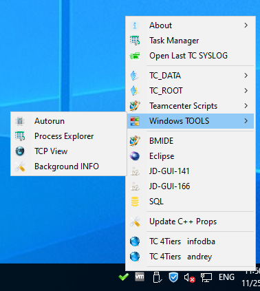
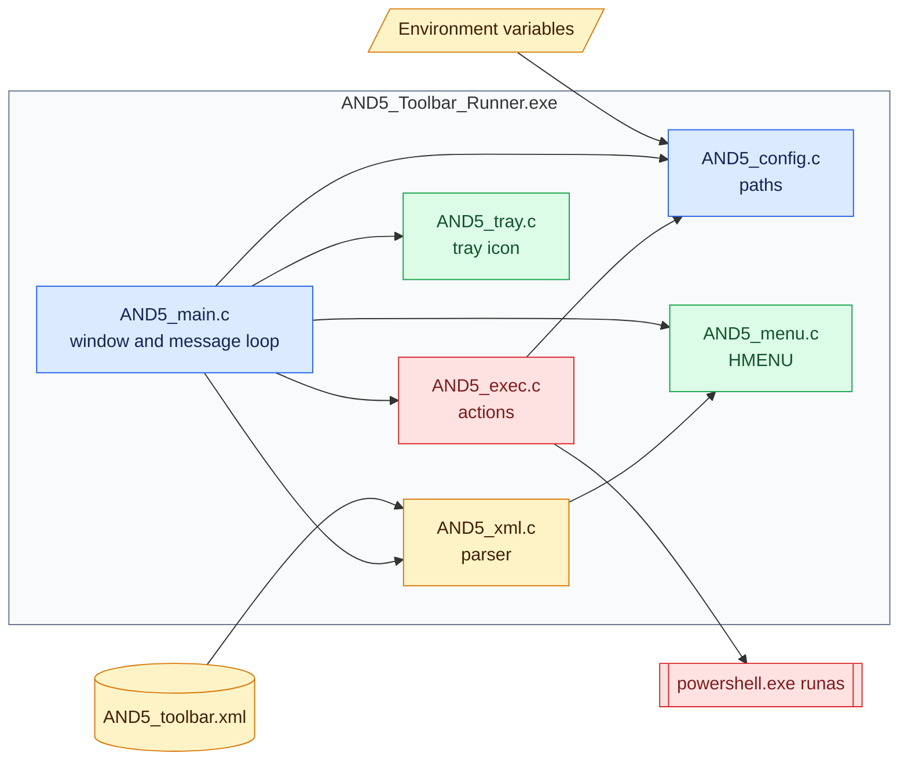
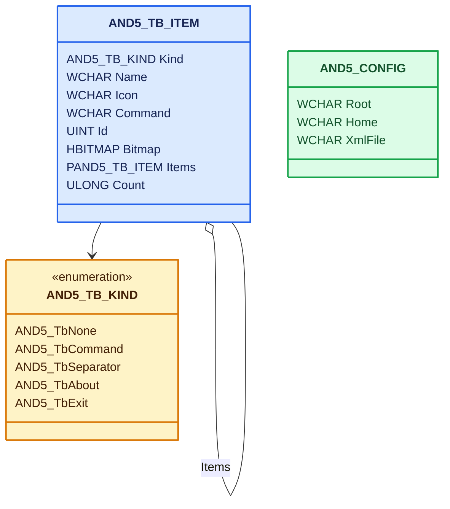
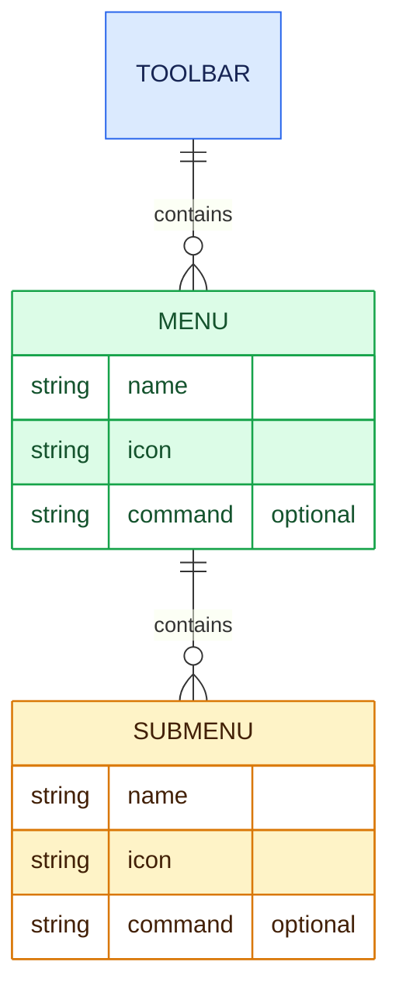
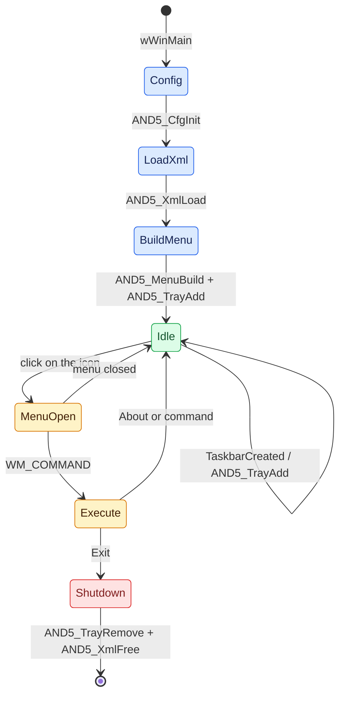
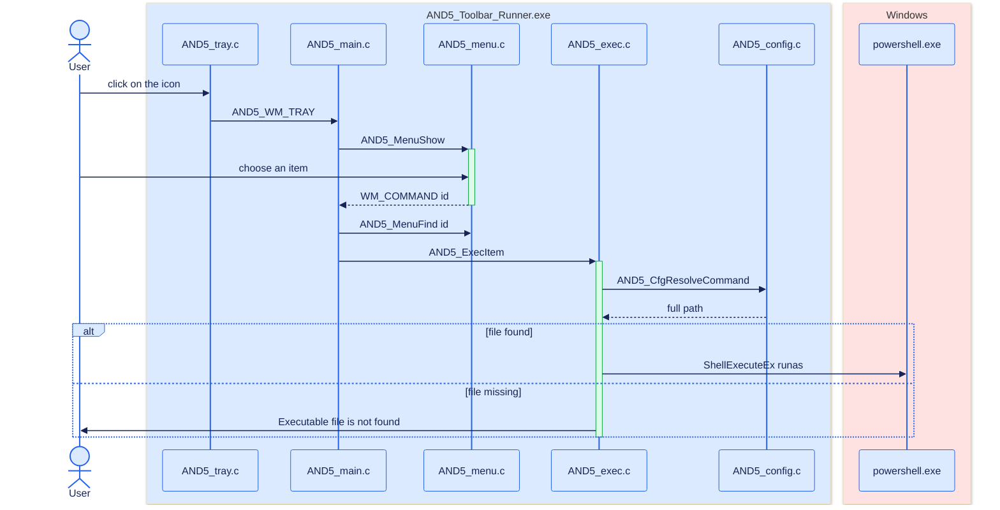
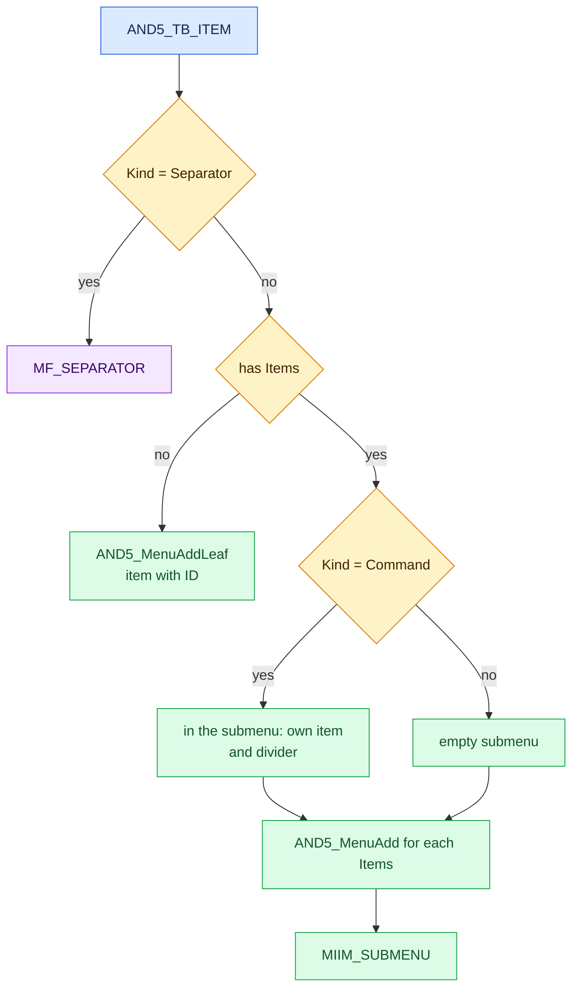

# AND5_Toolbar_Runner - full description

Short version: [README.md](../README.md).


<hr>

A Windows system tray toolbar. The tray icon opens a menu. The menu is built from `AND5_toolbar.xml`. A menu item runs a script or program as administrator.

**Status: working.** The program builds, reads `AND5_toolbar.xml`, shows the menu with icons and runs the commands (see [Status](#status)). Open items: single instance, and XML reload without restart.

The folder `AND5_SCRIPTS_HOME` in the repository is a working sample of the scripts root: it has `AND5_toolbar.xml`, scripts (`AND5_com`, `AND5_de`), programs (`BIN`) and icons.

---

## Contents

1. [What the program does](#what-the-program-does)
2. [UI example](#ui-example)
3. [Tech stack](#tech-stack)
4. [AND5_toolbar.xml format](#and5_toolbarxml-format)
5. [Environment variables and paths](#environment-variables-and-paths)
6. [Repository layout](#repository-layout)
7. [Diagrams](#diagrams)
8. [Build](#build)
9. [Run](#run)
10. [Status](#status)
11. [Differences from the PowerShell version](#differences-from-the-powershell-version)

---

## What the program does

- Adds an icon to the tray (`Shell_NotifyIcon`), tooltip `Andreys TOOLBAR`.
- Left and right click open the same menu.
- The menu and the submenus are built from XML. Items have `.ico` icons.
- `Separator` in the XML gives a divider.
- `About` without a command shows the About window. `Exit` without a command closes the program.
- An item with a command starts `powershell.exe` as administrator (`runas`). If the file is missing: warning `Executable file is not found.`
- After an Explorer restart the icon comes back to the tray (`TaskbarCreated`).

---

## UI example

The toolbar menu of the running program:



---

## Tech stack

| Layer | Solution |
|---|---|
| Language | C17, no C++, no runtimes |
| UI | Win32 API: hidden window, `Shell_NotifyIconW`, `CreatePopupMenu`, `TrackPopupMenuEx` |
| Menu icons | `LoadImageW` → 32-bit PARGB `HBITMAP` → `MENUITEMINFO.hbmpItem` (as `PhIconToBitmap` in System Informer) |
| XML | XmlLite (part of Windows), DTD prohibited |
| Paths | `GetEnvironmentVariableW`, `PathCchCombine` |
| Start | `ShellExecuteExW`, verb `runas` |
| Build | CMake + MSVC (Visual Studio 2022), `/MT`, Unicode, `/W4`, SubSystem Windows |

Code samples: `F:\DEV_HOME\SystemInformer_SRC` — `SystemInformer\notifico.c` (tray), `phlib\icotobmp.c` (icon → bitmap).

---

## AND5_toolbar.xml format

File: `AND5_SCRIPTS_HOME\AND5_toolbar.xml`. The icons are next to the scripts: `AND5_SCRIPTS_HOME\AND5_com\toolbar\*.ico`, `AND5_SCRIPTS_HOME\AND5_com\daily_scripts\*.ico`, `AND5_SCRIPTS_HOME\AND5_de\service_scripts\...`.

| Tag | Where | Purpose |
|---|---|---|
| `<toolbar>` | root | One per file |
| `<menu>` | in `<toolbar>` | Top-level item |
| `<submenu>` | in `<menu>` | Submenu item (one level of nesting) |
| `<name>` | in `<menu>`, `<submenu>` | Item text. `Separator`, `About`, `Exit` are special names |
| `<icon>` | in `<menu>`, `<submenu>` | Path to an `.ico`, relative to `%AND5_SCRIPTS_ROOT%`. Can be empty |
| `<command>` | in `<menu>`, `<submenu>` | `VARIABLE#relative\path`. Optional |

```xml
<toolbar>
	<menu>
		<name>TC_DATA</name>
		<icon>AND5_com\toolbar\folder.ico</icon>
		<command>AND5_SCRIPTS_ROOT#AND5_com\daily_scripts\TC_DATA.bat</command>
		<submenu>
			<name>model.xml</name>
			<icon>AND5_com\toolbar\xml.ico</icon>
			<command>AND5_SCRIPTS_ROOT#AND5_com\toolbar\201_open_model_xml.bat</command>
		</submenu>
	</menu>
	<menu>
		<name>Separator</name>
		<icon />
	</menu>
</toolbar>
```

How the item type (`AND5_TB_KIND`) is found:

| Condition (in this order) | Type |
|---|---|
| `name` = `Separator` | `AND5_TbSeparator` |
| has `command` | `AND5_TbCommand` |
| `name` = `About` | `AND5_TbAbout` |
| `name` = `Exit` | `AND5_TbExit` |
| else | `AND5_TbNone` (submenu group only) |

---

## Environment variables and paths

| Variable | Purpose |
|---|---|
| `AND5_SCRIPTS_ROOT` | Scripts root. `<icon>` and the tray icon `AND5_com\toolbar\AND5_ok.ico` are relative to it |
| `AND5_SCRIPTS_HOME` | Folder with `AND5_toolbar.xml` |

- XML path: the first command-line argument, else `%AND5_SCRIPTS_HOME%\AND5_toolbar.xml`.
- Command `AND5_SCRIPTS_ROOT#BIN\tcpview64.exe` → `%AND5_SCRIPTS_ROOT%\BIN\tcpview64.exe`.
- If there is no tray icon, the built-in icon from the resources is used (`AND5_SCRIPTS_HOME\AND5_com\toolbar\AND5_ok.ico`, put into the exe at build time by `src\AND5_app.rc`).
- If `AND5_SCRIPTS_ROOT` is not set, the root is `AND5_SCRIPTS_HOME` (or the XML folder, if the XML is given as an argument). The program also sets `AND5_SCRIPTS_ROOT` for itself, so that `AND5_SCRIPTS_ROOT#...` commands and the scripts find it. Without this the menu shows no icons.
- In the repository both variables point to one folder: `F:\DEV_HOME\AI_Projects\AND5_Toolbar_Runner\AND5_SCRIPTS_HOME`. The XML is directly in the scripts root.

To test on this copy:

```powershell
$env:AND5_SCRIPTS_ROOT = "F:\DEV_HOME\AI_Projects\AND5_Toolbar_Runner\AND5_SCRIPTS_HOME"
$env:AND5_SCRIPTS_HOME = $env:AND5_SCRIPTS_ROOT
F:\DEV_HOME\AI_Projects\AND5_Toolbar_Runner\bin\AND5_Toolbar_Runner.exe
```

---

## Repository layout

```
F:\DEV_HOME\AI_Projects\AND5_Toolbar_Runner\
├── CMakeLists.txt
├── README.md                        short description
├── SysTool_Design_Summary.md        design summary: goal, modules, layers
├── Mermaid_for_VSCode.md            supported Mermaid types
├── docs\
│   ├── README_FULL.md               full description (this file)
│   ├── UI_Example.png               screenshot of the menu
│   └── AND5_toolbar_EXAMPLE.xml     example menu
├── bin\
│   └── AND5_Toolbar_Runner.exe      build result
├── example\
│   └── Procmon64.exe                Sysinternals sample
├── AND5_SCRIPTS_HOME\               working sample of the scripts root
│   ├── AND5_toolbar.xml             menu description
│   ├── AND5_com\                    common scripts and icons
│   │   └── toolbar\                 toolbar scripts, icons, original PowerShell version
│   ├── AND5_de\                     development scripts (BMIDE, Eclipse, JD-GUI, SQL)
│   └── BIN\                         programs (Autoruns, TCP View, Bginfo)
└── src\
    ├── AND5_app.h          common types, constants, prototypes
    ├── AND5_main.c         wWinMain, hidden window, message loop
    ├── AND5_config.c       environment variables, paths
    ├── AND5_xml.c          AND5_toolbar.xml → AND5_TB_ITEM tree
    ├── AND5_icon.c         .ico → PARGB HBITMAP
    ├── AND5_menu.c         AND5_TB_ITEM tree → HMENU, find by ID
    ├── AND5_tray.c         tray icon
    ├── AND5_exec.c         About, Exit, run a command
    ├── AND5_resource.h
    ├── AND5_app.rc         program icon
    └── AND5_app.manifest   Common Controls v6, PerMonitorV2, asInvoker
```

---

## Diagrams

### 1. Modules



### 2. Data structures



- One structure `AND5_TB_ITEM` for the whole tree: root → `menu` → `submenu`.
- `Name` is 128 characters, `Icon` and `Command` are `MAX_PATH`.
- `Id` is set by `AND5_menu.c`: from `AND5_ID_FIRST` = 40000, in order.
- Memory: `HeapAlloc` / `HeapReAlloc`, released by `AND5_XmlFree`.

### 3. XML model



### 4. Life cycle



### 5. Click on a menu item



### 6. Menu build

In Win32 a group item cannot be clicked. Thus the command of the `menu` itself (for example `TC_DATA`) is the first line of its submenu, followed by a divider.



---

## Build

Needed: Visual Studio 2022 with the workload "Desktop development with C++" (it includes CMake).

From Developer PowerShell for VS 2022:

```powershell
cmake -S F:\DEV_HOME\AI_Projects\AND5_Toolbar_Runner -B F:\DEV_HOME\AI_Projects\AND5_Toolbar_Runner\build -G "Visual Studio 17 2022" -A x64
cmake --build F:\DEV_HOME\AI_Projects\AND5_Toolbar_Runner\build --config Release
```

Result: `bin\AND5_Toolbar_Runner.exe`. One file, no installer. The folder `build` has only intermediate files.

Or: Visual Studio → "Open Folder" → `F:\DEV_HOME\AI_Projects\AND5_Toolbar_Runner`.

---

## Run

```powershell
AND5_Toolbar_Runner.exe                     # XML from %AND5_SCRIPTS_HOME%
AND5_Toolbar_Runner.exe D:\path\my.xml      # custom XML
```

For autostart at logon: a shortcut in `shell:startup` or a task in Task Scheduler (as the `.ps1` is started now).

---

## Status

| Module | State |
|---|---|
| `AND5_main.c` | Done: window, message loop, `TaskbarCreated` |
| `AND5_tray.c` | Done |
| `AND5_config.c` | Done |
| `AND5_exec.c` | Done: About, Exit, `runas powershell.exe` |
| `AND5_icon.c` | Done: port of `PhIconToBitmap` (Buffered Paint, alpha from the mask) |
| `AND5_menu.c` | Done, with icons from `AND5_icon.c` |
| `AND5_xml.c` | Done: `AND5_XmlLoad` with XmlLite, DTD prohibited. If the file is bad, it gives the menu About / Exit and returns `FALSE` |

Tested: Release x64 build without warnings at `/W4`; the exe starts with `AND5_SCRIPTS_HOME\AND5_toolbar.xml`; the menu and the submenus show icons with transparency (screenshots).

Next steps:

- [x] `AND5_XmlLoad` with XmlLite (`CreateXmlReader`, `XmlReaderProperty_DtdProcessing = DtdProcessing_Prohibit`).
- [x] `MenuLoadIcon`: `.ico` → 32-bit PARGB `HBITMAP` (`AND5_icon.c`).
- [ ] Single instance (named mutex).
- [ ] Reload XML without restart (menu item or file watch).

---

## Differences from the PowerShell version

| PowerShell | C |
|---|---|
| WinForms `ContextMenuStrip`, `NotifyIcon` | Win32 `HMENU`, `Shell_NotifyIconW` |
| A `menu` item with a command and a submenu can be clicked itself | The command is the first line of the submenu (Win32 limit) |
| Command found by the item name (`$command_mapper`) | Found by `Id`: equal names do not conflict |
| `Start-Process powershell.exe <path>` | `powershell.exe -Command "& '<path>'"`: paths with spaces work |
| Console hidden with `ShowWindowAsync` | Not needed: SubSystem Windows, no console |
| Needs `AND5_options.ini` and `0__AND5_functions.ps1` | Does not need them |
| The icon does not come back after an Explorer restart | It comes back (`TaskbarCreated`) |
